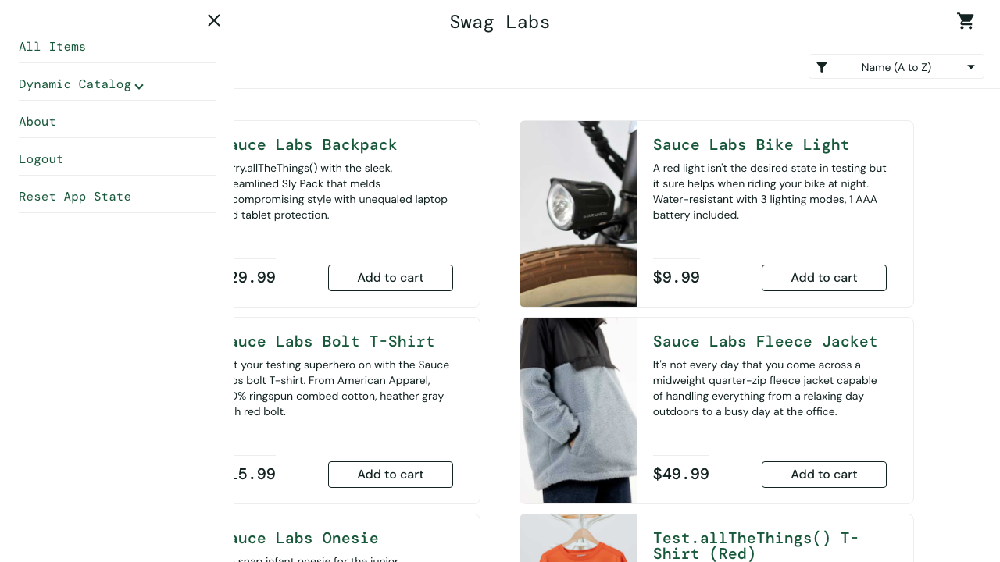

# Accessibility Testing

[](https://github.com/VincentJerico/accessibility-testing/actions/workflows/ci.yml)


Automated and keyboard accessibility testing against WCAG 2.2 AA, using Playwright and axe-core,
with a written audit of what it found.

> axe-core's WCAG rules found 0 violations on every [SauceDemo](https://www.saucedemo.com) page. The
> keyboard and manual audit found 7 WCAG failures, including one that stops a keyboard-only user from
> checking out. (axe's best-practice rule `page-has-heading-one`, which the WCAG gate leaves out, does
> flag F-5.) [Read the audit](docs/FINDINGS.md).

Automated scanners catch roughly 30 to 40% of accessibility issues. This repo covers that part, then
tests what a scanner can't: whether you can reach things by keyboard, whether focus is visible,
where focus goes and comes back to, focus hidden behind overlays, ARIA state and page structure.

## Findings at a glance

| ID  | Issue                                                    | WCAG                             | Severity |
| --- | -------------------------------------------------------- | -------------------------------- | -------- |
| F-1 | Cart is not reachable by keyboard, which blocks checkout | 2.1.1 Keyboard (A)               | Critical |
| F-2 | No visible focus indicator anywhere                      | 2.4.7 Focus Visible (AA)         | Serious  |
| F-3 | Menu toggle doesn't expose open/closed state             | 4.1.2 Name, Role, Value (A)      | Serious  |
| F-7 | Focus lands on links hidden behind the open menu         | 2.4.11 Focus Not Obscured (AA)   | Serious  |
| F-4 | Closing the menu drops focus to `<body>`                 | 2.4.3 Focus Order (A)            | Moderate |
| F-5 | Page titles are `<span>`s; pages have no headings        | 1.3.1 Info & Relationships (A)   | Moderate |
| F-6 | Placeholder is the only visible label                    | 3.3.2 Labels or Instructions (A) | Moderate |

Each finding has evidence, reproduction steps, a recommended fix, and a **tracking test**. See
[docs/FINDINGS.md](docs/FINDINGS.md).

<p align="center">
  
  <br><sub>F-7: keyboard focus is on the Backpack image link, completely under the open menu.</sub>
</p>

## How it's tested

| Layer                  | Where                                  | What it proves                                                                               |
| ---------------------- | -------------------------------------- | -------------------------------------------------------------------------------------------- |
| **Scanner self-test**  | `tests/scanner-selftest.spec.ts`       | The gate rejects planted defects by rule name, so a green run can't be a vacuous pass        |
| **Scanner validation** | `tests/w3c-bad.spec.ts`                | Catches W3C's broken demo; its repaired twin fails only `target-size` (F-8)                  |
| **Automated scan**     | `tests/saucedemo.axe.spec.ts`          | WCAG 2.2 AA axe scan of each page **and its interactive states** (errors, open menu)         |
| **Keyboard & ARIA**    | `tests/saucedemo.keyboard.spec.ts`     | Regression guards for what works: tab order, Enter, `role="alert"`, landmarks, ARIA snapshot |
| **Known issues**       | `tests/saucedemo.known-issues.spec.ts` | One test per finding pins today's defect; it goes red when the defect is fixed               |

### Design decisions

- **The WCAG 2.2 AA tag set.** axe tags each WCAG version separately, so the scan uses
  `wcag2a, wcag2aa, wcag21a, wcag21aa, wcag22aa`. The `best-practice` tag is left out because those
  rules aren't conformance requirements.
- **An audit trail on every scan.** `expectNoViolations()` attaches the full axe JSON to the test
  report. On failure, the message lists each rule with its impact, help URL and sample nodes.
- **No rule is disabled.** The W3C demo's `target-size` gap (F-8) is pinned as the only rule its
  repaired pages fail, instead of being switched off.
- **Checks that axe can't do.** `isFocusEntirelyObscured()` samples `elementFromPoint` at the focused
  element's corners and centre to test **SC 2.4.11**, which has no axe rule.
- **No timing-based flakes.** Menu tests wait for the slide transition to finish
  (`getAnimations()`), so focus and geometry are read on a stable DOM, not mid-transition.
- **Chromium only.** axe results depend on the DOM, not the browser. Keyboard focus behavior differs
  between browsers (Safari skips links on Tab by default), so a single engine keeps the audit
  deterministic.

## Getting started

```bash
npm install
npx playwright install chromium
npm test                 # everything
npm run test:axe         # @axe: automated scans + scanner validation
npm run test:keyboard    # @keyboard: keyboard audit
npm run report           # open the HTML report (includes axe JSON per scan)
```

## Scanning a page

```ts
import { test } from '@playwright/test';
import { expectNoViolations } from '../src/a11y.js';

test('checkout is accessible with a validation error shown', async ({ page }, testInfo) => {
  await page.goto('https://shop.example.com/checkout');
  await page.getByRole('button', { name: 'Continue' }).click(); // scan the error state too
  await expectNoViolations(page, testInfo, { exclude: ['#third-party-chat'] });
});
```

## Structure

```
accessibility-testing/
├── playwright.config.ts
├── src/
│   ├── a11y.ts          # axe wrapper: WCAG 2.2 AA tags, scan(), expectNoViolations()
│   ├── keyboard.ts      # reachableByTab(), isFocusEntirelyObscured(), walkTabStops()
│   ├── saucedemo.ts     # login, keyboard menu helpers
│   ├── targets.ts       # sites under test
│   ├── summary.ts       # the run summary every automation step reads
│   ├── report.ts        # summary -> markdown (job summary, PR comment)
│   └── issues.ts        # summary -> which regression issues to open, update or close
├── reporters/
│   └── summary-reporter.ts  # writes reports/a11y-summary.json after every run
├── gate/                # the reusable gate: spec, config, fixture pages, self-test
├── scripts/             # CI glue: report, PR comment, regression issues, results page
├── tests/               # self-tests · W3C validation · axe · keyboard · known issues
└── docs/
    ├── FINDINGS.md      # the audit report
    └── evidence/        # screenshots referenced by findings
```

## CI

[`.github/workflows/ci.yml`](.github/workflows/ci.yml) runs **lint · format · typecheck**, then the
accessibility suite in Chromium. It runs on every push and PR, and **weekly** as well, because both
sites under test are live and can change without this repo changing.

Every run writes `reports/a11y-summary.json` (status, finding ID, axe violations and error per
test), and the rest of the automation reads that one file:

| Job               | What it does                                                                                                                                                                                                              | When                                                               |
| ----------------- | ------------------------------------------------------------------------------------------------------------------------------------------------------------------------------------------------------------------------- | ------------------------------------------------------------------ |
| Accessibility     | Runs the suite, writes the results table to the job summary, uploads the HTML report                                                                                                                                      | Every run                                                          |
| PR comment        | Posts the same table on the PR as one comment, updated in place on each push                                                                                                                                              | Pull requests                                                      |
| Regression issues | Opens an issue per newly failing test, comments when the failure changes, closes it when the test passes again. A broken pin (F-1 ... F-8) gets its own title, because it means the defect was fixed or the page changed. | Weekly and manual runs of `main`; a dry run elsewhere              |
| Results page      | Publishes the latest run, a run-over-run trend and the Playwright report to GitHub Pages                                                                                                                                  | Runs of `main`, once Pages is on (repo variable `A11Y_PAGES=true`) |
| Gate self-test    | Proves the reusable gate fails a planted-bad page for the planted reasons and passes a clean one                                                                                                                          | Every run                                                          |
| Reusable gate     | Calls the gate the way another repo would, against the clean fixture                                                                                                                                                      | Every run                                                          |

The regression planner only touches issues labelled `a11y-automation`, ignores flaky passes, and
never closes an issue because a test didn't run, so a filtered or partial run can't close anything.
Its decisions are pinned by `tests/automation-selftest.spec.ts`.

## Use it as a gate in another repo

The same checks run as a reusable workflow, so any repo can gate its own pages on WCAG 2.2 AA:

```yaml
jobs:
  a11y:
    uses: VincentJerico/accessibility-testing/.github/workflows/a11y-gate.yml@main
    with:
      start-command: npm ci && npm start # runs in your repo, left running
      wait-for: http://localhost:3000/health
      urls: |
        http://localhost:3000/
        http://localhost:3000/settings
      exclude: '#third-party-chat' # optional
```

For each URL it runs an axe WCAG 2.2 AA scan and a keyboard walk: every tab stop must show a visible
focus indicator (2.4.7) and Tab must never get stuck (2.1.2). Any failure fails the caller's build,
and the results table lands in the caller's job summary. `keyboard: false` skips the keyboard walk.
Pin it with `@<sha>` and pass the same SHA as `gate-ref`.

`node gate/selftest.ts` proves the gate can fail: it must reject a page with planted defects (an
image with no alt, an unlabelled input, a button with its focus outline removed), report a planted
keyboard trap, pass a clean page, and fail when no URLs are given.

Run it locally against any page:

```bash
A11Y_URLS=http://localhost:3000/ npx playwright test -c gate/playwright.config.ts
```

## Limits

This audit is not a conformance claim. It did not include a screen reader pass, zoom/reflow testing,
or mobile testing. See [Not covered](docs/FINDINGS.md#not-covered-known-limits).
